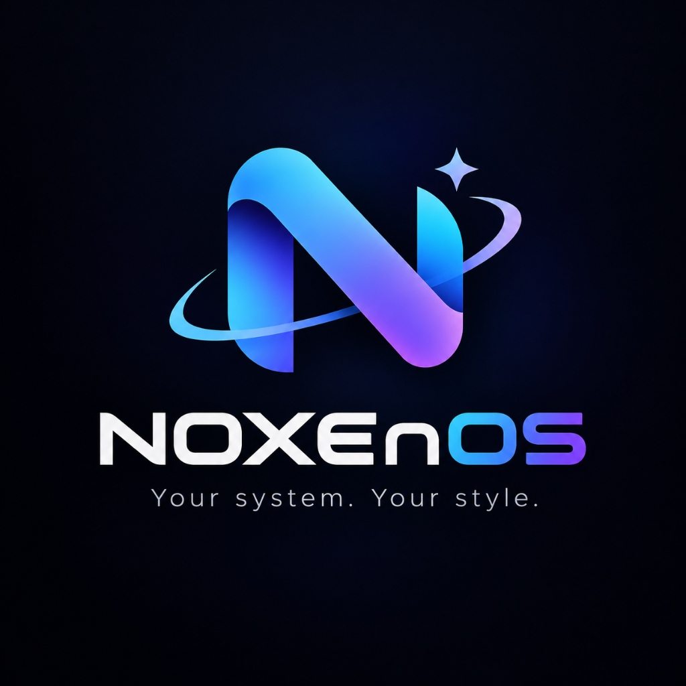

# NOXEnOS Linux

<p align="center">
  
</p>

<p align="center">
  <strong>«Your system. Your style.»</strong><br>
  Distribución Linux moderna, elegante y optimizada con flujo de trabajo inspirado en macOS e identidad tecnológica propia.
</p>

<p align="center">
  
  
  
  
  
</p>

---

## 🌟 Visión general

**NOXEnOS Linux** es un sistema operativo completo, arrancable e instalable diseñado para combinar la potencia y estabilidad del ecosistema **Ubuntu 24.04 LTS** con la elegancia, fluidez y productividad de un entorno de escritorio tipo macOS.

A diferencia de simples temas estéticos o maquetas web, este repositorio contiene la **ingeniería completa de construcción de una imagen ISO real**, que incluye:
- Modo Live para probar el sistema sin alterar el disco.
- Instalador gráfico amigable **Calamares** totalmente adaptado.
- Suite ofimática completa **LibreOffice** en español con accesos directos independientes.
- Dock inferior con **efecto de aumento parabólico (magnificación fluida)** al pasar el ratón.
- Barra superior discreta con menú global, reloj, bandeja de sistema y menú NOXEnOS.
- Optimización de memoria RAM con **ZRAM (compresión zstd)** y parámetros de kernel optimizados.
- Tienda de software real (**Discover**) compatible con repositorios oficiales APT y Flatpak/Flathub.

---

## 🎨 Identidad visual y Branding

- **Logotipo oficial:** Emblema futurista con la «N» estilizada en gradiente azul eléctrico a violeta, anillo orbital y estrella guía.
- **Paleta de color:** Negro espacial (`#0a0d14`), pizarra profunda (`#0e121d`), acentos en cian eléctrico (`#00d2ff`) y violeta ciberpunk (`#8a2be2`).
- **Colección de 5 fondos de pantalla exclusivos en 4K y 21:9:**
  1. `noxenos-dark-futuristic.png` *(Predeterminado en 4K 3840x2160)*
  2. `noxenos-abstract-minimal.png` *(4K 3840x2160)*
  3. `noxenos-neon-gradient.png` *(4K 3840x2160)*
  4. `noxenos-light-pure.png` *(4K 3840x2160)*
  5. `noxenos-ultrawide.png` *(Panorámico 21:9 3440x1440)*
- **Tipografía moderna:** Inter y Hack para una legibilidad nítida en pantallas HiDPI y estándar.
- **Ventanas:** Controles de ventana situados a la izquierda (Cerrar, Minimizar, Maximizar) con sutiles sombras y desenfoque translúcido (*blur*).

---

## 🖥️ Entorno de escritorio

### 1. Barra superior
- **Menú NOXEnOS:** Lanzador de aplicaciones rápido y categorizado.
- **Menú Global:** La barra de menús (*Archivo, Editar, Ver...*) de las aplicaciones se integra de forma limpia en la barra superior al estilo macOS.
- **Bandeja de sistema:** Controladores nativos de Wi-Fi, Ethernet, Bluetooth, volumen de audio PipeWire, estado de batería y notificaciones.
- **Reloj y Calendario:** Formato en español con fecha y hora actual.

### 2. Dock inferior
- Implementado mediante **Plank** con tema exclusivo `NOXEnOS-DarkGlass` (cristal oscuro translúcido).
- **Animación de aumento (zoom parabólico):** Al mover el cursor sobre los iconos, estos se agrandan suavemente con aceleración gráfica.
- **Indicadores luminosos:** Puntos de luz cian bajo las aplicaciones en ejecución.
- **Acceso directo integrado a los 9 elementos clave:**
  1. 📁 **Archivos** (Dolphin)
  2. 🌐 **Navegador** (Firefox)
  3. 🛍️ **NOXEnOS Store** (Discover)
  4. 📝 **LibreOffice Writer**
  5. 📊 **LibreOffice Calc**
  6. 📽️ **LibreOffice Impress**
  7. 💻 **Terminal** (Konsole)
  8. ⚙️ **Ajustes del Sistema** (System Settings)
  9. 🗑️ **Papelera**

---

## 📦 Software preinstalado

| Categoría | Aplicación | Descripción |
| :--- | :--- | :--- |
| **Ofimática** | LibreOffice 24.x | Writer, Calc, Impress, Draw, Math y Base con compatibilidad DOCX, XLSX, PPTX, ODF y PDF |
| **Navegación** | Mozilla Firefox | Navegador moderno con aceleración gráfica y soporte multimedia completo |
| **Archivos** | Dolphin | Gestor con pestañas, paneles divididos, previsualizaciones y papelera |
| **Multimedia** | VLC Media Player | Reproductor universal para audio y vídeo |
| **Imágenes** | Gwenview & Spectacle | Visor de imágenes avanzado y utilidad de capturas de pantalla |
| **Tienda** | Discover | Gestor de software conectado a APT y Flatpak |
| **Terminal** | Konsole | Emulador de terminal con pestañas y perfiles |
| **Copias de seguridad**| Timeshift | Protección y restauración del sistema mediante instantáneas |
| **Ajustes rápidos** | `noxo-control` | Centro de personalización (Modo Oscuro/Claro, Fondos, Rendimiento) |
| **Bienvenida** | `noxo-welcome` | Asistente de inicio para nuevos usuarios y acceso al instalador |

---

## 📁 Estructura del repositorio

```text
NOXEnOS/
├── README.md                           # Documentación principal
├── LICENSE                             # Licencia GPL-3.0
├── Dockerfile                          # Contenedor para compilación reproducible
├── docs/                               # Guías técnicas detalladas
│   ├── arquitectura.md                 # Especificaciones de ingeniería
│   ├── compilacion.md                  # Manual para compilar la ISO
│   ├── instalacion.md                  # Manual de instalación y Live
│   ├── personalizacion.md              # Guía de temas, dock y apariencias
│   └── solucion-de-problemas.md        # Resolución de incidencias
├── branding/                           # Identidad corporativa
│   ├── logos/                          # Emblemas, vectores y logos originales
│   ├── wallpapers/                     # Colección de 5 fondos 4K y ultrawide
│   └── icons/                          # Árbol hicolor de iconos (16px a 512px)
├── config/                             # Archivos de configuración
│   ├── desktop/                        # Ajustes de Plasma, KWin y Plank
│   ├── packages/                       # Listas de paquetes APT (core, desktop, apps...)
│   ├── installer/                      # Configuración de Calamares y branding
│   ├── plymouth/                       # Tema de arranque animado
│   ├── sddm/                           # Pantalla de inicio de sesión
│   ├── skel/                           # Perfil por defecto de los usuarios
│   └── optimization/                   # Ajustes de ZRAM y sysctl
├── scripts/                            # Scripts de automatización
│   ├── build-iso.sh                    # Generador de la ISO en Linux
│   ├── build-in-docker.sh              # Generador de la ISO en Docker
│   ├── build-iso-windows.ps1           # Orquestador para Windows (WSL/Docker)
│   ├── check-dependencies.sh           # Verificador de herramientas
│   ├── verify-iso.sh                   # Validador de integridad SHA-256 y eltorito
│   ├── test-build.sh                   # Ejecutor de pruebas
│   ├── run-vm.ps1                      # Lanzador de prueba en VirtualBox (Windows)
│   ├── noxo-control                    # Utilidad CLI/GUI de ajustes
│   └── noxo-welcome                    # Asistente de bienvenida
├── tests/                              # Suite de pruebas unitarias
└── output/                             # Destino de la ISO final (NOXEnOS.iso)
```

---

## 🚀 Cómo compilar la ISO

Para generar la imagen oficial `output/NOXEnOS.iso`, dispones de 3 métodos:

### Método 1: En Linux nativo o WSL 2 (Ubuntu 24.04)
```bash
# 1. Comprobar e instalar dependencias
sudo apt update
sudo apt install -y debootstrap squashfs-tools xorriso grub-pc-bin grub-efi-amd64-bin mtools dosfstools isolinux

# 2. Ejecutar la compilación
sudo bash scripts/build-iso.sh

# 3. Verificar el resultado
bash scripts/verify-iso.sh output/NOXEnOS.iso
```

### Método 2: En Docker (Windows / Mac / Linux)
```bash
bash scripts/build-in-docker.sh
```

### Método 3: Desde Windows PowerShell
```powershell
# Ejecuta el orquestador automático
.\scripts\build-iso-windows.ps1
```

---

## 🧪 Pruebas y verificación en máquina virtual

Una vez generada la imagen en `output/NOXEnOS.iso`:

### En Windows con VirtualBox:
```powershell
# Crea automáticamente la máquina virtual en VirtualBox y arranca la ISO
.\scripts\run-vm.ps1
```

### Ejecución de la suite de pruebas unitarias:
```bash
python3 -m unittest discover -s tests -p "test_*.py" -v
```

---

## 📄 Créditos y Licencia

Diseñado y desarrollado por el equipo de **NOXEnOS Linux**.
Distribuido bajo licencia libre [GNU General Public License v3.0](LICENSE).
Ubuntu es una marca registrada de Canonical Ltd. KDE y Plasma son marcas registradas de KDE e.V.
